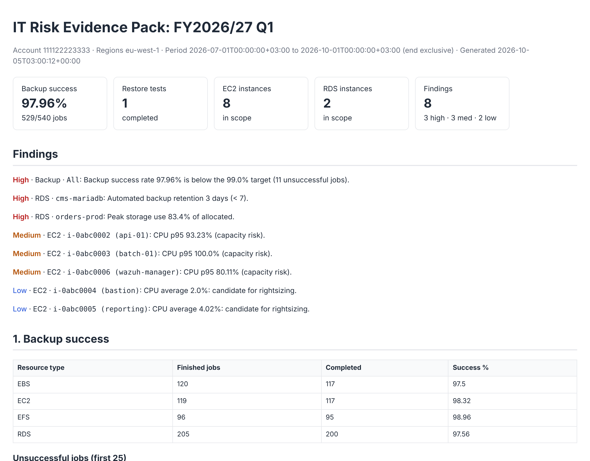

# AWS Quarterly IT-Risk Evidence Pack

A serverless Lambda that produces the quarterly evidence an **IT Risk Manager** asks a cloud team for:

1. **Backup success**: every AWS Backup job in the fiscal quarter, the success rate per resource type, failed jobs, and restore-test evidence.
2. **EC2 CPU utilisation**: average, p95 and peak CPU per instance across the quarter.
3. **RDS utilisation**: CPU, connections, freeable memory, peak storage use, backup retention and encryption per DB instance.

It runs automatically after each quarter closes. It writes a tamper-evident pack (HTML summary, CSVs and a SHA-256 manifest) to a locked-down S3 bucket, and emails the risk manager through SNS.



> See a full example generated from synthetic data in [`docs/sample/`](docs/sample/).

## Why

Quarterly risk reviews usually mean someone exporting screenshots from three consoles, pasting them into a spreadsheet and hoping nothing was missed. This replaces that with a repeatable, auditable job:

- **Same method every quarter.** Fixed fiscal-quarter boundaries (July-start FY by default, set to Africa/Nairobi time) and documented thresholds.
- **Findings, not just data.** Low backup success, missing restore tests, capacity risk (CPU p95 of 80% or more), idle instances, RDS storage pressure, short backup retention, unencrypted storage and monitoring gaps are all flagged with a severity.
- **Integrity.** Every file is hashed into `manifest.sha256`. The bucket is versioned, encrypted, TLS-only, blocks public access and keeps evidence for about 7 years.
- **Least privilege.** The function is read-only against the estate. It can only write to its own bucket and publish to its own topic.

## Architecture

```
EventBridge Scheduler (06:00 EAT, 5th of Jan/Apr/Jul/Oct)
        │
        ▼
  Lambda (python3.12, arm64) ──► AWS Backup  ListBackupJobs / ListRestoreJobs
        │                    ──► EC2         DescribeInstances
        │                    ──► RDS         DescribeDBInstances
        │                    ──► CloudWatch  GetMetricData (batched, 500 queries/call)
        ▼
  S3  it-risk-reports/<account>/<FY2026-27-Q1>/<timestamp>/
        summary.html  summary.json  findings.csv  backup_jobs.csv
        restore_jobs.csv  ec2_utilisation.csv  rds_utilisation.csv  manifest.sha256
        │
        ▼
  SNS ──► email to the IT Risk Manager
```

**Why hourly metrics?** CloudWatch keeps 5-minute datapoints for only 63 days but 1-hour datapoints for 455 days. Hourly resolution is the finest that is reliably available across a whole past quarter. p95 is computed from those hourly averages.

## Deploy

Requires the [AWS SAM CLI](https://docs.aws.amazon.com/serverless-application-model/latest/developerguide/install-sam-cli.html).

```bash
sam build
sam deploy --guided \
  --parameter-overrides Regions=eu-west-1,af-south-1 FyStartMonth=7 \
                        NotificationEmail=risk.manager@example.com
```

The subscriber has to confirm the SNS email once.

### Run for a specific quarter

```bash
aws lambda invoke --function-name <FunctionName> \
  --payload file://events/fy2026-27-q1.json --cli-binary-format raw-in-base64-out out.json
```

With no payload, the function reports on the **last completed** quarter.

## Configuration

| Env var | Default | Meaning |
|---|---|---|
| `REGIONS` | function region | Comma-separated regions in scope |
| `FY_START_MONTH` | `7` | First month of the fiscal year |
| `REPORT_UTC_OFFSET_HOURS` | `3` | Timezone for quarter boundaries (EAT) |
| `BACKUP_SUCCESS_TARGET_PCT` | `99` | Backup success target |
| `CPU_HIGH_P95_PCT` | `80` | CPU p95 that flags capacity risk |
| `CPU_LOW_AVG_PCT` | `10` | Average CPU that flags rightsizing |
| `STORAGE_HIGH_PCT` | `80` | RDS peak storage that flags risk |
| `MIN_BACKUP_RETENTION_DAYS` | `7` | Minimum RDS automated-backup retention |

## Develop

```bash
pip install -r requirements-dev.txt
pytest -q                          # quarter maths, collectors (botocore Stubber), findings, manifest, HTML escaping
ruff check . && cfn-lint template.yaml
python scripts/generate_sample.py  # regenerate docs/sample from synthetic data
```

## Limitations and roadmap

- Instances terminated before the report runs aren't listed. Pair this with AWS Config for a full inventory history.
- Aurora storage is cluster-level, so peak storage % is skipped for Aurora instances.
- Planned: a multi-account mode (assume a read-only role in each member account), AWS Backup copy-job evidence, and S3 Object Lock for WORM retention.

## License

MIT
